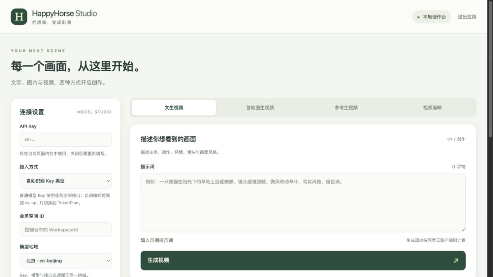

# 阿里云 TokenPlan · HappyHorse Studio

基于 **阿里云 Model Studio TokenPlan API** 的本地可视化视频创作工具，支持 HappyHorse 文生视频、首帧图生视频、参考生视频和视频编辑。支持 TokenPlan 套餐接入，也可使用普通 API 按量付费接入；具体可用模型以对应账户与套餐为准。

这是第三方本地客户端。后端仅使用 Python 标准库，不需要安装项目依赖。源码版需要 Python 3.9+，Windows 单文件 EXE 无需安装 Python。

## 下载 Windows 版

前往 [GitHub Releases](https://github.com/JasonQu1/aliyun-tokenplan-happyhorse-studio/releases/latest) 下载 `HappyHorseStudio-Windows-x64.zip`，解压后双击 `HappyHorseStudio.exe`。适用于 Windows 10/11 64 位。

使用自己的 API Key。TokenPlan 用户从控制台“我的订阅”获取套餐专用 Key，选择“TokenPlan 套餐”或“自动识别 Key 类型”。程序不会内置或保存你的密钥。

## 启动

- Windows EXE：从 Releases 下载压缩包，解压后双击 `HappyHorseStudio.exe`。浏览器自动打开创作台，页面右上角“退出应用”可停止后台服务。
- macOS：双击 `Start.command`。
- Windows：安装 Python 3.9+ 后双击 `Start.bat`。
- 终端：`python3 server.py`（Windows 可用 `py -3 server.py`）。

浏览器会自动打开 http://127.0.0.1:8765。源码版保持启动终端运行，关闭终端、按 Ctrl+C 或点击“退出应用”结束服务。源码版端口冲突时运行 `python3 server.py --port 8766`；EXE 会自动选择可用端口。已启动同版本程序时，再次双击可重新打开页面。

## 使用

1. 普通 API：在百炼 / Model Studio 控制台获取同一地域的 API Key 和业务空间 ID。TokenPlan：从“我的订阅”获取套餐专用 Key。
2. 在界面中填写连接信息，选择模式和模型版本。
3. 添加所需素材、输入提示词并点击“生成视频”。
4. 系统每 15 秒查询，成功后自动保存到 `downloads/` 并显示视频与保存路径。
5. 可以暂停轮询并从任务历史恢复。暂停不取消云端任务。历史不保存密钥和素材。

API Key 只保留在当前浏览器页面与处理请求时的服务内存中，不写入磁盘，不存到浏览器存储。业务空间、地域、版本和最近任务元数据保存在浏览器 localStorage。图片在提交时以 Base64 或公网链接发送到阿里云。

## TokenPlan 接入

接入方式默认“自动识别 Key 类型”。检测到 `sk-sp-` 前缀时，提交与查询都使用 `https://token-plan.ap-southeast-1.maas.aliyuncs.com`，固定新加坡地域，无需 WorkspaceId。也可以手动选择“TokenPlan 套餐”。套餐请求消耗 Credits，不会自动切换到按量付费。

`sk-sp-` 前缀也用于 Coding Plan，前缀无法区分产品；请确认 Key 是 TokenPlan“我的订阅”生成的专用 Key。普通 API Key 与套餐接口不能混用。

TokenPlan 的模型可用范围以控制台订阅列表为准。HappyHorse 1.1 文生视频、首帧图生视频和参考生视频可通过对应套餐模型接入；视频编辑和 1.0 版本不保证包含在套餐内。工具不会为不支持的模型自动改用普通按量付费。

[官方 TokenPlan 视频提交与轮询示例](https://www.alibabacloud.com/help/en/model-studio/token-plan-multimodal-gen)

## 四种模式

| 模式 | 素材 | 参数差异 |
| --- | --- | --- |
| 文生视频 | 提示词 | 480P/720P/1080P、3～15 秒、画面比例 |
| 首帧图生视频 | 1 张图片，提示词可选 | 比例跟随首帧，不发送 ratio |
| 参考生视频 | 1～9 张图片、提示词 | 按界面顺序用 `[Image 1]` 等指代图片主体 |
| 视频编辑 | 1 个公网视频链接，0～5 张参考图、提示词 | 固定模型 happyhorse-1.0-video-edit，仅 720P/1080P，可保留原声；不发送 duration/ratio |

首帧及编辑参考图：宽高均 ≥300 px，宽高比 1:2.5～2.5:1。参考生视频图：短边 ≥400 px。全部图片仅支持 JPEG/PNG/WEBP，单张 ≤20 MB。本地图片在浏览器中校验尺寸、类型和大小；远端链接的文件规格由云端校验。

编辑视频需 MP4/MOV，3～60 秒、≤100 MB，长边 ≤4096 px、短边 ≥360 px，宽高比 1:2.5～2.5:1，帧率 8～60 fps。输出与输入时长一致，但输入超过 15 秒时只处理前 15 秒。编辑视频目前只接受公网 URL，本地视频需先自行上传 OSS 等公网存储。

## 查询与下载

任务 ID 与云端视频链接有效期均为 24 小时。刷新页面后重新填写 Key，可以从历史恢复查询。提交失败不会自动重发；如果提交超时，请先在控制台检查是否已经创建任务，避免重复计费。查询错误会用原任务 ID 重试，连续失败 3 次后暂停。

自动下载仅接受云端返回的 HTTPS `*.aliyuncs.com` 链接；如结果域名不同或保存失败，可以使用“云端视频链接”下载。源码版视频保存在本目录的 `downloads/`；打包应用保存在用户目录 `Videos/HappyHorse/`。可用 `--output /你的目录` 改变保存位置。

应用只监听 127.0.0.1，无需开放端口。生成调用按阿里云账户规则计费。真实 API 联调需要用户 Key；离线测试不会创建付费任务。

## Windows EXE 打包

开发者可以在 Windows 上安装 Python 后双击 `Build-Windows.bat`，输出 `dist/HappyHorseStudio.exe`。EXE 启动后打开浏览器界面，不显示命令行窗口；使用 EXE 的电脑无需安装 Python。

也可以在 GitHub 的 **Actions → Build Windows EXE → Run workflow** 手动构建。工作流会运行测试，并上传 Windows EXE 压缩包。源码仓库不提交生成视频、密钥、旧定制图片和构建产物。

已使用 Windows Python 3.13.16、PyInstaller 6.22.3 在隔离 Wine 9.0 环境生成单文件 x64 EXE。9 项回归测试通过；在全新未安装 Python 的 Wine 前缀验证 EXE 启动、页面与背景素材、TokenPlan 接入保护和退出功能。尚未在真实 Windows 电脑实机测试或用真实 API Key 完成视频生成。构建记录见 `WINDOWS-BUILD.md`。

## 测试

`python3 -m unittest -v test_server.py`

## 官方文档

- [文生视频](https://help.aliyun.com/zh/model-studio/happyhorse-text-to-video-api-reference)
- [首帧图生视频](https://help.aliyun.com/zh/model-studio/happyhorse-image-to-video-api-reference)
- [参考生视频](https://help.aliyun.com/zh/model-studio/happyhorse-reference-to-video-api-reference)
- [视频编辑](https://help.aliyun.com/zh/model-studio/happyhorse-video-edit-api-reference)

参数依据 2026-10-13 阅读的官方中文文档；地域可用模型与计费以控制台为准。
